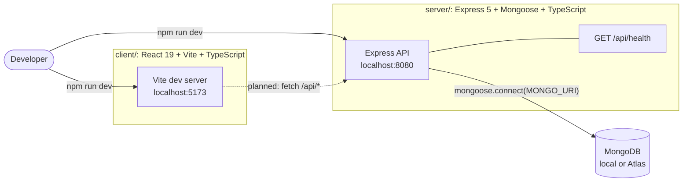
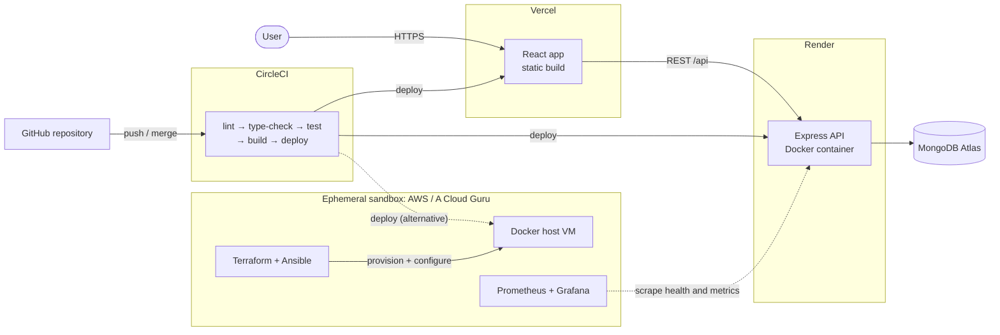
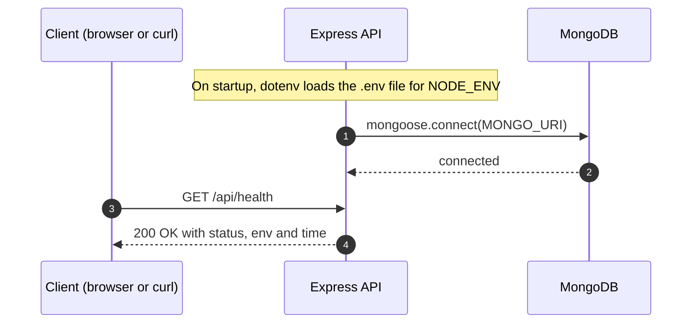
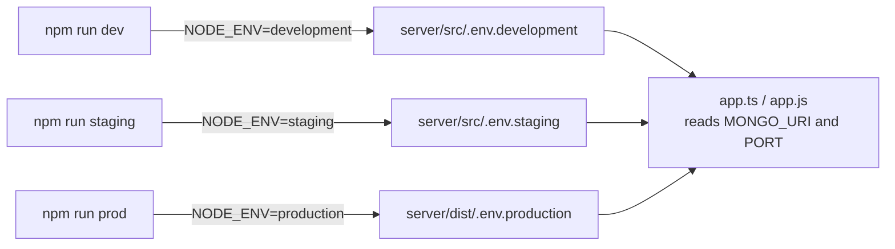
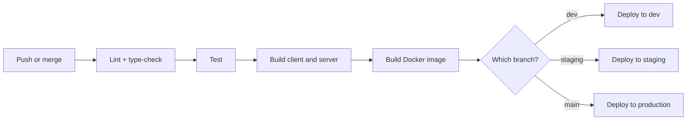
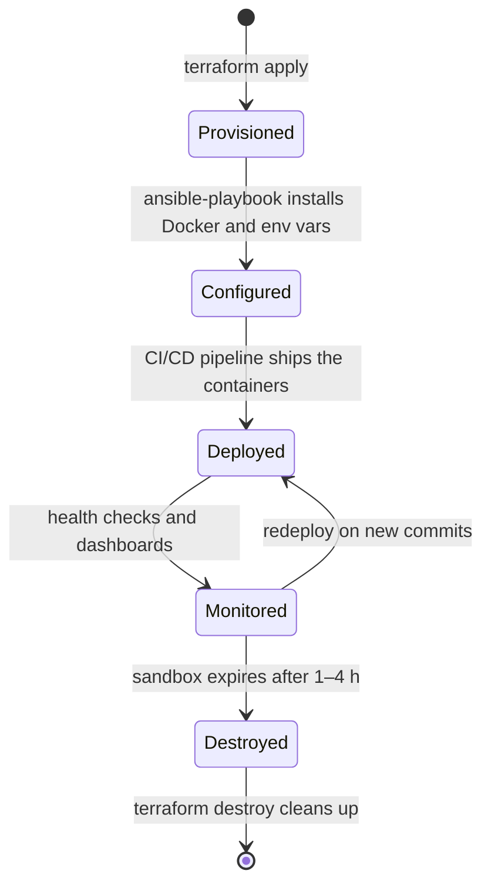
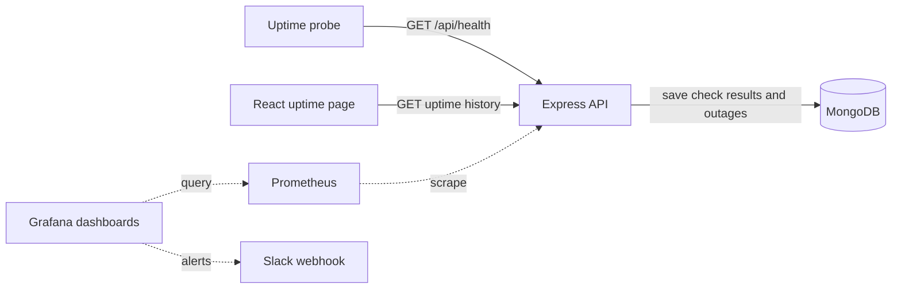

# 🌀 Ephemeral Cloud Deployment

A hands-on DevOps project: build a three-tier web app (React + Express + MongoDB) and practise deploying it to **short-lived ("ephemeral") cloud environments** using **containers**, **CI/CD**, **infrastructure as code** and **monitoring**.

> **Status: early stage.** The React client and the Express API are scaffolded, the API connects to MongoDB, and it serves a health-check endpoint. Containers, CI/CD, IaC and monitoring are still to come. See the [Roadmap](#-roadmap).

---

## 📚 Table of Contents

- [Why "Ephemeral"?](#-why-ephemeral)
- [Architecture](#-architecture)
  - [Current State](#current-state)
  - [Target State](#target-state)
  - [Request Flow](#request-flow)
- [Tech Stack](#-tech-stack)
- [Repository Structure](#-repository-structure)
- [Getting Started](#-getting-started)
- [Configuration](#-configuration)
- [API Reference](#-api-reference)
- [CI/CD Pipeline (Planned)](#-cicd-pipeline-planned)
- [Environment Lifecycle (Planned)](#-environment-lifecycle-planned)
- [Monitoring (Planned)](#-monitoring-planned)
- [Roadmap](#-roadmap)
- [Learning Goals](#-learning-goals)

---

## ⏳ Why "Ephemeral"?

Cloud sandboxes such as the **AWS sandbox** or **A Cloud Guru** playgrounds only last **1–4 hours** before they are wiped. To work within that limit, everything has to be reproducible from code:

1. **Provision** the infrastructure automatically (Terraform).
2. **Configure** the servers automatically (Ansible).
3. **Deploy** the app through a pipeline (CircleCI).
4. **Verify** it with health checks and monitoring.
5. **Tear it all down**, then rebuild it from scratch next time.

The aim is that redeploying takes minutes instead of an afternoon.

---

## 🏗️ Architecture

### Current State

What is in the repository today:



- **client/** is still the Vite + React starter page. It doesn't call the API yet.
- **server/** loads per-environment settings, connects to MongoDB through Mongoose and exposes `/api/health`.

### Target State

Where the project is heading:



| Layer | Platform | Purpose |
|-------|----------|---------|
| Frontend | **Vercel** | Static hosting (free tier) |
| Backend | **Render** (Docker) | REST API |
| Database | **MongoDB Atlas** | Managed database (free tier) |
| Infra provisioning | **AWS sandbox / A Cloud Guru** | Short-lived compute |
| CI/CD | **CircleCI** | Build, test and deploy |

### Request Flow



> The health check doesn't query MongoDB yet. It only reports that the API process is up.

---

## 🧰 Tech Stack

| Layer | Technology | Status |
|-------|------------|:------:|
| Frontend | React 19, Vite (`rolldown-vite` 7.1), TypeScript 5.8, ESLint 9 | ✅ Scaffolded |
| Backend | Express 5, Mongoose 8, TypeScript 5.9, ts-node, nodemon | ✅ Scaffolded |
| Config | dotenv (one env file per environment), cross-env | ✅ Done |
| Database | MongoDB (local by default) or MongoDB Atlas | ✅ Connected |
| Containers | Docker, Docker Compose | 🔜 Planned |
| CI/CD | CircleCI | 🔜 Planned |
| IaC | Terraform, Ansible | 🔜 Planned |
| Monitoring | Prometheus, Grafana | 🔜 Planned |
| Hosting | Vercel (frontend), Render (backend) | 🔜 Planned |

---

## 🗂️ Repository Structure

```text
ephemeral-cloud-deployment/
├── client/                    # React + Vite + TypeScript (starter page for now)
│   ├── public/
│   ├── src/
│   │   ├── App.tsx
│   │   └── main.tsx
│   ├── index.html
│   ├── vite.config.ts
│   ├── eslint.config.js
│   └── package.json
├── server/                    # Express 5 + Mongoose API (TypeScript, ES modules)
│   ├── src/
│   │   └── app.ts             # Entry point: env loading, MongoDB connection, routes
│   ├── nodemon.json           # Dev: watch src/ and run through the ts-node ESM loader
│   ├── tsconfig.json          # Compiles to dist/
│   └── package.json
├── .gitignore
└── README.md
```

**Planned additions:** `infra/terraform/`, `infra/ansible/`, `.circleci/config.yml`, a `Dockerfile` for each service, and `docker-compose.yml`.

---

## 🚀 Getting Started

### Prerequisites

- **Node.js 20.19+** (or 22.12+), required by Vite 7
- **npm**
- **MongoDB**: either a local instance on `mongodb://localhost:27017` or a MongoDB Atlas connection string

### 1. Run the API

```bash
cd server
npm install

# Create the development env file (see Configuration below)
echo "MONGO_URI=mongodb://localhost:27017/ephemeral-dev" > src/.env.development
echo "PORT=8080" >> src/.env.development

npm run dev
```

Check that it works:

```bash
curl http://localhost:8080/api/health
# {"status":"ok","env":"development","time":"2025-10-12T08:00:00.000Z"}
```

### 2. Run the Client

```bash
cd client
npm install
npm run dev        # http://localhost:5173
```

### Available Scripts

**server/**

| Script | `NODE_ENV` | What it runs |
|--------|-----------|--------------|
| `npm run dev` | `development` | `src/app.ts` with nodemon and ts-node, reloading on changes |
| `npm run staging` | `staging` | `src/app.ts` with ts-node, without reloading |
| `npm run build` | – | `tsc`, which compiles to `dist/` |
| `npm run prod` | `production` | `dist/app.js` with plain Node (run `build` first) |

**client/**

| Script | What it runs |
|--------|--------------|
| `npm run dev` | Vite dev server with hot reload |
| `npm run build` | Type-check, then a production build into `dist/` |
| `npm run lint` | ESLint |
| `npm run preview` | Serve the production build locally |

---

## 🔧 Configuration

The server picks its env file based on `NODE_ENV`. It loads `.env.<NODE_ENV>` from the **same folder as the running entry file**:



| Variable | Default | Description |
|----------|---------|-------------|
| `MONGO_URI` | `mongodb://localhost:27017/mydatabase` | MongoDB connection string (local or Atlas) |
| `PORT` | `8080` | Port the API listens on |
| `NODE_ENV` | `development` | Set by the npm scripts through `cross-env` |

**Notes**

- `tsc` doesn't copy `.env` files into `dist/`. In production, either put `.env.production` in `dist/` yourself or set the variables on the host (Render, Docker and so on). dotenv never overrides variables that are already set.
- These files contain credentials. Make sure `.gitignore` covers them before you commit.

---

## 📡 API Reference

### `GET /api/health`

Reports whether the API is up and which environment it is running in.

**Response `200 OK`**

```json
{
  "status": "ok",
  "env": "development",
  "time": "2025-10-12T08:00:00.000Z"
}
```

| Field | Type | Description |
|-------|------|-------------|
| `status` | string | Always `"ok"` while the process is running |
| `env` | string | The current `NODE_ENV` |
| `time` | string (ISO 8601) | Server time when the request was handled |

---

## 🔁 CI/CD Pipeline (Planned)

CircleCI will build and test both apps, then deploy based on the branch:



- A failure at any stage stops the pipeline.
- Changes are promoted from **dev** to **staging** to **production** by merging branches.

---

## ♻️ Environment Lifecycle (Planned)

One sandbox session from start to finish:



---

## 📊 Monitoring (Planned)

The app's own feature is an **uptime tracker**. The API records health-check results and outages in MongoDB, and the client shows uptime history on a single page.



---

## 🗺️ Roadmap

**Application**
- [x] Scaffold the React + Vite + TypeScript client
- [x] Scaffold the Express 5 + TypeScript server (ES modules)
- [x] Per-environment config (development, staging, production)
- [x] MongoDB connection through Mongoose
- [x] `GET /api/health` endpoint
- [ ] Record and serve outage times
- [ ] Uptime page in the client

**DevOps**
- [ ] Dockerfiles for client and server, plus `docker-compose.yml` for local runs
- [ ] CircleCI pipeline with lint, type-check, test, build and deploy
- [ ] Deploy the client to Vercel and the API to Render
- [ ] Terraform for sandbox infrastructure (VMs, networking, storage)
- [ ] Ansible playbooks for server setup
- [ ] Prometheus + Grafana dashboards
- [ ] NGINX reverse proxy
- [ ] Blue-green deployments
- [ ] Slack alerts for failed builds and outages

---

## 🧠 Learning Goals

- Practise the full **DevOps lifecycle** under time-limited environments
- Build **CI/CD pipelines** with multi-environment promotion
- Use **containers** to make deployments consistent across environments
- Practise **infrastructure as code** with Terraform and Ansible
- Add **monitoring and alerting** to a running service

---

**Author:** David Bato ([@DavidBatoDev](https://github.com/DavidBatoDev))  
**Project:** *Ephemeral Cloud Deployment*  
**Stack:** React, Express, MongoDB, Docker, Terraform/Ansible, CircleCI
